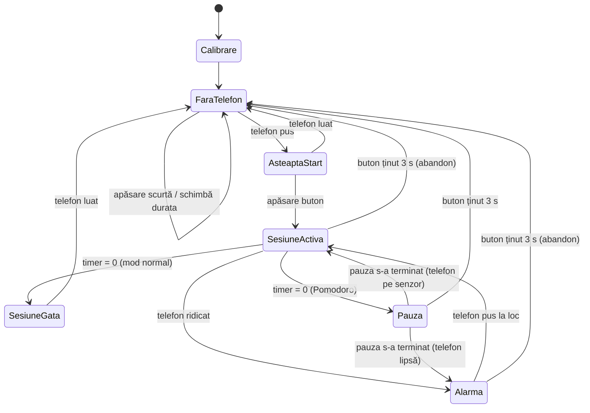

# Sistem anti-distragere cu Arduino

Proiect realizat pentru disciplina **SIO**. Sistemul îl ajută pe utilizator să se concentreze în timpul învățatului: telefonul mobil este așezat pe un senzor de presiune, se pornește o sesiune cu durată fixă (sau o sesiune Pomodoro), iar dacă telefonul este ridicat înainte de finalul sesiunii, se declanșează o alarmă sonoră și vizuală. Sistemul păstrează și statistici despre sesiuni, salvate în memoria EEPROM a plăcii.

---

## Cuprins

1. [Componente hardware](#1-componente-hardware)
2. [Conexiuni](#2-conexiuni)
3. [Biblioteci folosite](#3-biblioteci-folosite)
4. [Principiul de funcționare](#4-principiul-de-funcționare)
5. [Stările sistemului](#5-stările-sistemului)
6. [Citirea senzorului de presiune](#6-citirea-senzorului-de-presiune)
7. [Butonul: debounce și tipuri de apăsări](#7-butonul-debounce-și-tipuri-de-apăsări)
8. [Timerul sesiunii](#8-timerul-sesiunii)
9. [Modul Pomodoro](#9-modul-pomodoro)
10. [Alarma](#10-alarma)
11. [Statistici salvate în EEPROM](#11-statistici-salvate-în-eeprom)
12. [Afișajul LCD și bara de progres](#12-afișajul-lcd-și-bara-de-progres)
13. [LED-uri și buzzer](#13-led-uri-și-buzzer)
14. [Modul de test](#14-modul-de-test)
15. [Ghid de utilizare](#15-ghid-de-utilizare)
16. [Parametri configurabili](#16-parametri-configurabili)
17. [Etapele dezvoltării](#17-etapele-dezvoltării)
18. [Limitări și dezvoltări viitoare](#18-limitări-și-dezvoltări-viitoare)

---

## 1. Componente hardware

| Componentă | Rol |
|---|---|
| Placă Arduino | controlează întregul sistem |
| Senzor de presiune FSR (Force Sensitive Resistor) | detectează dacă telefonul este așezat pe „cântar” |
| Display LCD 16×2 cu modul I2C | afișează durata, timpul rămas, bara de progres și mesajele |
| LED roșu | semnalizează lipsa telefonului / alarma |
| LED verde | semnalizează telefon prezent / sesiune activă; clipește în ultimul minut |
| Buzzer | alarmă la ridicarea telefonului, bipuri la finalul fazelor |
| Buton | alegerea duratei, pornirea și anularea sesiunii, navigarea în statistici |

## 2. Conexiuni

| Componentă | Pin Arduino |
|---|---|
| Senzor FSR (în divizor de tensiune cu un rezistor) | `A0` |
| LED roșu (cu rezistor de limitare) | `4` |
| LED verde (cu rezistor de limitare) | `5` |
| Buzzer | `6` |
| Buton (celălalt terminal la GND) | `7` |
| LCD I2C – SDA / SCL | pinii I2C ai plăcii (pe Arduino Uno/Nano: `A4` / `A5`) |

Butonul folosește **rezistorul intern de pull-up** al plăcii (`INPUT_PULLUP`), deci nu are nevoie de rezistor extern: pinul citește `HIGH` când butonul nu este apăsat și `LOW` când este apăsat.

## 3. Biblioteci folosite

- `Wire.h` – comunicația I2C
- `hd44780.h` + `hd44780ioClass/hd44780_I2Cexp.h` – controlul LCD-ului prin modulul I2C (biblioteca *hd44780* de Bill Perry, care detectează automat adresa I2C a modulului)
- `EEPROM.h` – salvarea statisticilor în memoria nevolatilă a plăcii

## 4. Principiul de funcționare

1. La pornire, sistemul **calibrează senzorul** („tara”): măsoară valoarea senzorului fără nimic pe el și o scade din toate citirile ulterioare.
2. Utilizatorul **alege durata** sesiunii cu apăsări scurte pe buton (15 / 25 / 45 / 60 de minute sau Pomodoro).
3. Utilizatorul **pune telefonul pe senzor** și **apasă butonul** → sesiunea pornește.
4. Cât timp telefonul stă pe senzor, **timerul numără descrescător**, iar pe LCD apar timpul rămas și o bară de progres.
5. Dacă telefonul este **ridicat înainte de final**, **timerul se oprește** și începe un **timp de grație de 3 secunde**. Dacă telefonul nu este pus la loc în acest timp, pornește o **alarmă progresivă** (bipuri rare, apoi dese, apoi sunet continuu). Când telefonul este pus la loc, alarma se oprește, iar timerul continuă de unde a rămas.
6. Când timerul ajunge la zero, se aud **3 bipuri**, iar telefonul poate fi luat fără alarmă.
7. Fiecare eveniment important (sesiune terminată, sesiune abandonată, telefon ridicat, timp studiat) este **salvat în EEPROM**.

## 5. Stările sistemului

Programul este construit ca o **mașină de stări**. Logica internă folosește patru **faze** (`FAZA_NIMIC`, `FAZA_LUCRU`, `FAZA_PAUZA`, `FAZA_GATA`), iar combinate cu prezența telefonului rezultă șase **stări afișate**:

| Stare | Situație | LCD (rândul 0 / rândul 1) | LED roșu | LED verde | Buzzer |
|---|---|---|---|---|---|
| 0 | fără telefon, fără sesiune | durata aleasă / „Pune telefonul!” | aprins | stins | oprit |
| 1 | telefon pus, sesiune nepornită | durata aleasă / „Apasa START” | stins | aprins | oprit |
| 2 | sesiune activă, telefon pe senzor | timp + bară / „Sesiune activa” sau „Lucru 2/4” | stins | aprins (clipește în ultimul minut) | oprit |
| 3 | sesiune activă, telefon ridicat | timp + bară / „Pune-l la loc 3…1”, apoi „PUNE-L LA LOC!” | aprins (clipește în faza finală) | stins | 3 s liniște, apoi alarmă progresivă (vezi secțiunea 10) |
| 4 | timer terminat, telefonul poate fi luat | „Sesiune gata!” / „Poti lua telef.” | stins | aprins | 3 bipuri |
| 5 | pauză Pomodoro | timp + bară / „Pauza” sau „Pauza lunga” | stins | stins | oprit |



Ieșirile (LCD, LED-uri, buzzer) sunt actualizate **doar la schimbarea stării**, nu la fiecare trecere prin `loop()`. Astfel LCD-ul nu pâlpâie și nu se trimit date inutile pe I2C. Singurele elemente actualizate periodic sunt timerul și bara de progres (o dată pe secundă) și LED-ul verde care clipește în ultimul minut.

## 6. Citirea senzorului de presiune

Senzorul FSR își scade rezistența când este apăsat, iar tensiunea citită pe `A0` crește. Citirea trece prin mai multe etape:

1. **Medie pe mai multe eșantioane** – funcția `citesteMedie(n)` citește senzorul de `n` ori (la 2 ms distanță) și face media aritmetică. La calibrare se folosesc 50 de eșantioane, iar în funcționare normală 15.
2. **Scăderea tarei** – din medie se scade `valoareZero` (valoarea senzorului gol, măsurată la pornire). Valorile negative (zgomot) sunt forțate la 0.
3. **Filtru exponențial** – valoarea este netezită cu formula
   `filtrat = 0.70 × filtrat_anterior + 0.30 × valoare_nouă`.
   Coeficienții 0.70 / 0.30 au fost aleși experimental, urmărind valorile în Serial Monitor: elimină fluctuațiile, dar sistemul reacționează în continuare repede.
4. **Zona moartă** – valorile filtrate sub 1.5 sunt forțate la 0.
5. **Pragul de detecție** – telefonul este considerat prezent dacă valoarea filtrată este cel puțin `PRAG_USOR = 15`. Pragul a fost stabilit prin teste în Serial Monitor.

Valoarea filtrată este trimisă continuu pe portul serial (9600 baud), ca să poată fi urmărită în Serial Monitor / Serial Plotter.

> Variabila se numește `grameFiltrate`, dar cât timp `factorCalibrare = 1.0` valorile sunt unități brute ale convertorului analog-digital, nu grame reale.

## 7. Butonul: debounce și tipuri de apăsări

Un buton mecanic „sare” (bounce) câteva milisecunde la apăsare și la eliberare. Funcția `citesteButon()` acceptă o schimbare de stare doar dacă citirea rămâne neschimbată cel puțin **30 ms** (debounce). Pe lângă asta, funcția măsoară cât timp a fost ținut butonul și întoarce un **eveniment**:

| Eveniment | Condiție | Când este generat |
|---|---|---|
| `EV_SCURT` | buton eliberat după mai puțin de 1 s | la eliberare |
| `EV_LUNG` | buton eliberat după 1–3 s | la eliberare |
| `EV_FOARTE_LUNG` | buton ținut 3 s | imediat ce se ating 3 s, fără să mai aștepte eliberarea |

Ce face butonul în fiecare situație:

| Situație | Acțiune |
|---|---|
| fără telefon pe senzor | apăsare scurtă → următoarea durată (15 → 25 → 45 → 60 → Pomodoro → 15 …); ținut 3 s → meniul de statistici |
| telefon pe senzor, sesiune nepornită | apăsare → **sesiunea pornește imediat** |
| sesiune activă sau alarmă | ținut 3 s → **abandonarea sesiunii** |
| pauză Pomodoro | ținut 3 s → oprirea ciclului Pomodoro |
| ecranul de statistici | scurt → pagina următoare; 1–3 s → ieșire; 3 s pe pagina de reset → ștergerea statisticilor |

O apăsare deja „consumată” (de exemplu cea care a pornit sesiunea sau cea care a abandonat-o) este ignorată până la eliberare. Astfel, ținerea butonului apăsat după pornire nu abandonează sesiunea, iar ținerea lui după abandon nu repornește o sesiune nouă.

## 8. Timerul sesiunii

Timerul folosește `millis()`, nu `delay()`, așa că programul continuă să citească senzorul și butonul în timp ce numără.

- La fiecare trecere prin `loop()` se calculează cât timp a trecut față de trecerea anterioară (`trecut = millis() - ultimulMillis`).
- În faza de lucru, `timpRamasMs` scade cu `trecut` **numai cât timp telefonul este pe senzor**. Dacă telefonul este ridicat, timerul se oprește. Astfel utilizatorul nu poate „păcăli” sistemul ținând telefonul în mână până expiră timpul.
- Timpul scurs cu telefonul pe senzor se adună și în timpul total de studiu din statistici.
- Pe LCD timpul este afișat în formatul `MM:SS`, rotunjit în sus (nu apare `00:00` înainte de final).

Duratele disponibile sunt definite în vectorul:

```cpp
const byte DURATE_MIN[NR_OPTIUNI] = {15, 25, 45, 60, 0}; // 0 = Pomodoro
```

## 9. Modul Pomodoro

Tehnica Pomodoro alternează intervale de lucru concentrat cu pauze scurte:

| Fază | Durată | Telefonul |
|---|---|---|
| Lucru | 25 min | trebuie să stea pe senzor (altfel alarmă) |
| Pauză scurtă | 5 min | poate fi luat |
| Pauză lungă (după fiecare al 4-lea interval de lucru) | 15 min | poate fi luat |

- Pe LCD se afișează intervalul curent: „Lucru 1/4”, „Lucru 2/4” etc.
- În pauză timpul curge indiferent de poziția telefonului, iar ambele LED-uri sunt stinse.
- La finalul fiecărei faze se aud 3 bipuri.
- După pauză, **următorul interval de lucru pornește automat**. Dacă telefonul nu este pus la loc în acel moment, pornește imediat alarma.
- Ciclurile continuă până când utilizatorul le oprește ținând butonul apăsat 3 s.

## 10. Alarma

Când telefonul este ridicat în timpul fazei de lucru, timerul se oprește, iar sistemul trece prin următoarele etape (timpul se măsoară de la ridicarea telefonului):

| Etapă | Interval | Buzzer | LED roșu | LCD rândul 1 |
|---|---|---|---|---|
| Timp de grație | 0 – 3 s | liniște | aprins | „Pune-l la loc 3”, „… 2”, „… 1” |
| Alarmă – faza 1 | 3 – 8 s | bip de 100 ms la fiecare secundă | aprins | „PUNE-L LA LOC!” |
| Alarmă – faza 2 | 8 – 13 s | bip de 100 ms la fiecare 300 ms | aprins | „PUNE-L LA LOC!” |
| Alarmă – faza 3 | după 13 s | ton continuu de 250 Hz | clipește (200 ms) | „PUNE-L LA LOC!” |

- **Timpul de grație** permite ajustarea poziției telefonului fără să pornească alarma. Dacă telefonul este pus la loc în primele 3 secunde, sesiunea continuă normal și ridicarea **nu** se numără în statistici.
- **Alarma progresivă** semnalează întâi discret, apoi tot mai insistent.
- Contorul de ridicări din statistici crește cu 1 în momentul în care expiră timpul de grație (o singură dată pentru fiecare ridicare).
- Fiecare bip este pornit o singură dată, cu `tone(pin, frecvență, durată)`, la începutul intervalului său. Astfel durata bipului nu depinde de cât durează o trecere prin `loop()`.

Alarma se oprește când telefonul este pus la loc sau când sesiunea este abandonată (buton ținut 3 s).

## 11. Statistici salvate în EEPROM

Memoria EEPROM păstrează datele și după ce placa nu mai este alimentată. Statisticile sunt grupate într-o structură salvată de la adresa 0:

```cpp
struct Statistici {
  uint16_t magic;         // valoare de control (0x5A17)
  uint16_t terminate;     // sesiuni (intervale de lucru) duse până la capăt
  uint16_t abandonate;    // sesiuni anulate cu butonul ținut 3 s
  uint16_t ridicari;      // de câte ori a fost ridicat telefonul peste timpul de grație
  uint32_t secundeStudiu; // timp total de studiu cu telefonul pe senzor
};
```

- **Valoarea `magic`**: la prima rulare EEPROM-ul conține valori aleatoare (de obicei `0xFF`). Dacă la pornire câmpul `magic` nu este `0x5A17`, statisticile sunt inițializate cu zero.
- **Salvarea** se face cu `EEPROM.put()`, care scrie doar octeții modificați. Asta contează pentru că EEPROM-ul are un număr limitat de scrieri (aproximativ 100 000 pe celulă). Scrierea se face doar la evenimente (sesiune terminată, abandonată, telefon ridicat), nu continuu.
- **Timpul de studiu** se acumulează în milisecunde într-o variabilă din RAM și se mută în EEPROM, în secunde întregi, la finalul sau la abandonarea unei sesiuni.

**Vizualizarea statisticilor** se poate face în două moduri:

- **fără telefon pe senzor** (ecranul „Pune telefonul!”), se ține butonul apăsat 3 secunde;
- sau se ține butonul apăsat în momentul alimentării plăcii (ori în timp ce se apasă butonul RESET).

Ecranul are 3 pagini:

| Pagina | Rândul 0 | Rândul 1 |
|---|---|---|
| 1 | `Terminate: N` | `Abandonate: N` |
| 2 | `Ridicari: N` | `Studiu: XhYYm` |
| 3 | `Reset statistici` | `tine apasat 3s` |

## 12. Afișajul LCD și bara de progres

LCD-ul are 2 rânduri a câte 16 caractere. Toate mesajele au cel mult 16 caractere, iar funcția `scrieRand()` completează fiecare rând cu spații, ca să nu rămână litere din mesajul anterior.

În timpul sesiunii, rândul 0 arată astfel:

```
24:13 ████▌.....
```

- primele 6 caractere: timpul rămas (`MM:SS` + spațiu),
- următoarele 10 caractere: **bara de progres**.

Bara folosește **caractere personalizate** definite cu `lcd.createChar()`. Fiecare căsuță a LCD-ului are 5 coloane de pixeli, așa că s-au definit 6 caractere: cu 0, 1, 2, 3, 4 și 5 coloane umplute. Bara are astfel o rezoluție de 10 × 5 = **50 de pași**, nu doar 10, și avansează fluid:

```
pixeli_umpluți = timp_scurs × 50 / durata_totală
```

## 13. LED-uri și buzzer

| Semnal | Semnificație |
|---|---|
| LED roșu aprins | telefonul lipsește (înainte de sesiune) sau alarmă |
| LED verde aprins | telefon prezent / sesiune activă / sesiune terminată |
| LED verde clipind (500 ms) | ultimul minut al intervalului de lucru |
| ambele LED-uri stinse | pauză Pomodoro |
| bipuri rare → bipuri dese → ton continuu 250 Hz | alarmă progresivă: telefonul a fost ridicat de peste 3 s |
| LED roșu clipind (200 ms) | faza finală a alarmei |
| 3 bipuri de 1000 Hz | finalul unei faze (lucru sau pauză) |
| sunet grav scurt (150 Hz) | sesiune abandonată |

## 14. Modul de test

Pentru testare și prezentare, așteptarea de 25 de minute nu este practică. În cod există constanta:

```cpp
const bool MOD_TEST = false;
```

Cu `MOD_TEST = true`, toate duratele sunt interpretate în **secunde** în loc de minute (de exemplu Pomodoro devine 25 s lucru / 5 s pauză / 15 s pauză lungă). Toate stările sistemului pot fi astfel demonstrate în câteva minute. Pe LCD, durata este afișată cu unitatea corespunzătoare („sec” / „min”).

## 15. Ghid de utilizare

1. **Alimentează placa** fără nimic pe senzor și nu atinge senzorul cât timp pe ecran scrie „Calibrare... Nu atinge!” (aproximativ 2 s).
2. **Alege durata**: cât timp pe ecran scrie „Pune telefonul!”, fiecare apăsare scurtă pe buton schimbă durata de pe rândul de sus.
3. **Pune telefonul** pe senzor. Pe ecran apare „Apasa START”.
4. **Apasă butonul**. Sesiunea pornește și apar timpul rămas și bara de progres.
5. Lasă telefonul pe senzor până la final. Dacă îl ridici, pornește alarma până îl pui la loc.
6. La final se aud 3 bipuri și apare „Sesiune gata!”. Acum poți lua telefonul.
7. **Anulare**: ține butonul apăsat 3 s în timpul sesiunii.
8. **Statistici**: fără telefon pe senzor, ține butonul apăsat 3 s (sau ține-l apăsat în timp ce alimentezi placa). Navighezi cu apăsări scurte și ieși ținând butonul 1–3 s.

## 16. Parametri configurabili

| Constantă | Valoare | Descriere |
|---|---|---|
| `PRAG_USOR` | 15 | pragul peste care telefonul este considerat prezent |
| `DURATE_MIN` | {15, 25, 45, 60, 0} | duratele disponibile în minute (0 = Pomodoro) |
| `optiuneDurata` | 1 | durata selectată implicit la pornire (indexul 1 = 25 min) |
| `POMO_LUCRU` | 25 | durata unui interval de lucru Pomodoro (min) |
| `POMO_PAUZA` | 5 | durata pauzei scurte (min) |
| `POMO_PAUZA_LUNGA` | 15 | durata pauzei lungi (min) |
| `POMO_CICLURI` | 4 | după câte intervale de lucru urmează pauza lungă |
| `DEBOUNCE_MS` | 30 | timpul de stabilizare a butonului (ms) |
| `PRAG_LUNG_MS` | 1000 | pragul pentru apăsarea lungă (ms) |
| `PRAG_FOARTE_LUNG_MS` | 3000 | pragul pentru apăsarea foarte lungă / abandon (ms) |
| `GRATIE_MS` | 3000 | timpul de grație după ridicarea telefonului (ms) |
| `FAZA1_MS` | 5000 | durata fazei cu bipuri rare a alarmei (ms) |
| `FAZA2_MS` | 10000 | momentul (de la pornirea alarmei) după care sunetul devine continuu (ms) |
| `MOD_TEST` | false | `true` = duratele sunt în secunde (pentru teste) |

## 17. Etapele dezvoltării

1. **Sketch inițial** – citirea senzorului FSR cu medie pe mai multe eșantioane, tară la pornire, filtru exponențial (0.85 / 0.15) și afișarea valorii pe LCD.
2. **LED-uri și detecția telefonului** – adăugarea LED-urilor roșu și verde și a unui prag de prezență a telefonului („Telefon prezent” / „Pune telefonul”).
3. **Praguri de presiune** – trei niveluri de apăsare (ușor / mediu / foarte tare) stabilite prin teste în Serial Monitor, coeficienții filtrului ajustați la 0.70 / 0.30 și cod comentat (feedback primit la viză). Pentru sistemul final s-a păstrat doar pragul de prezență (`PRAG_USOR`).
4. **Buzzer** – semnalizarea sonoră.
5. **Sesiune activă** – pornirea sesiunii cu butonul și alarma la ridicarea telefonului (mașina cu stările 0–3).
6. **Timer pentru sesiune** – sesiunea are o durată fixă, telefonul poate fi luat fără alarmă abia după expirarea timpului, iar timerul se oprește cât timp telefonul este ridicat.
7. **Funcționalități extinse**:
   - alegerea duratei din buton (15 / 25 / 45 / 60 min),
   - modul Pomodoro (25 / 5 min, pauză lungă de 15 min după 4 cicluri),
   - debounce și detectarea apăsărilor scurte, lungi și foarte lungi,
   - anularea sesiunii prin ținerea butonului apăsat 3 s,
   - statistici salvate în EEPROM, vizibile din meniul deschis cu butonul ținut 3 s,
   - bara de progres pe LCD cu caractere personalizate,
   - LED-ul verde clipește în ultimul minut,
   - modul de test (durate în secunde).
8. **Timp de grație și alarmă progresivă** – dezvoltate pe branch-ul `feature-grace-alarma-buton` și integrate în versiunea finală: 3 secunde de grație cu numărătoare inversă, apoi alarmă în trei faze (bipuri rare, bipuri dese, sunet continuu cu LED roșu intermitent).

## 18. Limitări și dezvoltări viitoare

- **Calibrare în grame reale**: cu o greutate cunoscută s-ar putea determina `factorCalibrare`, iar sistemul ar putea cere o greutate minimă, ca să nu poată fi păcălit cu alt obiect pus pe senzor în locul telefonului.
- **Detectarea înlocuirii telefonului**: memorarea greutății la START și declanșarea alarmei la o schimbare bruscă a acesteia.
- **Comunicare externă**: un modul Bluetooth (HC-05) sau o aplicație pe PC care să citească statisticile pe portul serial și să facă grafice.
- **Modul RTC** pentru data și ora reală a sesiunilor.
